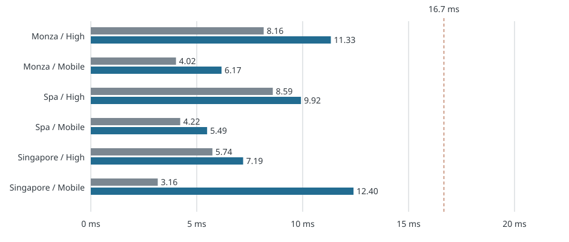

# Rendering observations

## After review: shared stand geometry and lighter per-frame prop work

Head 374e509 against master a3f672d, the two builds run one after the other (head, master, head, master, …) on the same host, each run on two cores under the GPU lock. Monza has five pairs, Spa and Singapore three. Other agents kept the host at load 2 to 6.4 (per run in `review-fixes-perf.json`), so compare pairs, not absolutes: Monza's first two pairs ran at load 5.4 to 6.4 and master itself drew 30 and 52 fps there. Grid: the last slot with nineteen cars ahead. High 1920×1080; Mobile 844×390 at an emulated DPR 3. Each cell lists the runs in order, master → head. Master's own screenshot tool does not record load times, so its first two pairs have none; from the third pair on both builds ran the same tool.

| Circuit / preset | Vsync fps, grid | Uncapped draw ms, grid | Uncapped draw ms, drive | Calls, grid | Triangles M, grid | JS heap MB | Session start s | Time to ready s | Prop warm ms |
| --- | --- | --- | --- | --- | --- | --- | --- | --- | --- |
| Monza / High | 30.0, 52.2, 60.0, 55.3, 54.5 → 40.8, 49.5, 58.1, 58.9, 54.3 | 29.91, 11.25, 8.37, 9.33, 17.22 → 27.37, 27.00, 10.19, 18.86, 16.48 | 21.20, 12.05, 8.77, 9.37, 17.41 → 23.41, 13.75, 11.41, 12.08, 16.41 | 1,055 → 1,145 | 5.18 → 9.69 | 177, 177, 199, 188, 199 → 239, 239, 239, 239, 254 | 3.94, 4.00, 4.31 → 12.48, 8.65, 5.23, 5.41, 8.56 | 5.02, 5.20, 5.69 → 14.65, 9.90, 5.97, 6.25, 9.85 | 0, 0, 0 → 1324, 994, 476, 548, 860 |
| Monza / Mobile | 59.6, 60.0, 60.0, 60.0, 59.9 → 58.1, 59.8, 60.0, 60.0, 60.0 | 14.41, 3.91, 4.26, 11.65, 6.55 → 14.51, 12.40, 7.45, 10.95, 6.75 | 14.40, 3.25, 3.85, 5.12, 4.11 → 11.91, 10.19, 4.76, 8.19, 6.73 | 384 → 454 | 1.48 → 2.28 | 77, 77, 77, 72, 72 → 116, 92, 92, 116, 92 | 2.05, 3.49, 2.76 → 6.23, 3.95, 3.17, 2.82, 2.64 | 2.66, 4.52, 3.83 → 7.64, 4.64, 3.60, 3.27, 3.07 | 0, 0, 0 → 747, 396, 235, 255, 260 |
| Spa / High | 60.0, 60.0, 60.0 → 60.0, 60.0, 60.0 | 8.27, 8.21, 10.10 → 9.41, 8.49, 10.46 | 14.55, 14.46, 14.60 → 14.95, 14.29, 14.36 | 878 → 937 | 4.49 → 5.25 | 269, 286, 269 → 342, 342, 342 | 5.90 → 7.38, 7.23, 7.38 | 7.19 → 8.14, 7.94, 8.10 | 0 → 793, 748, 775 |
| Spa / Mobile | 60.0, 60.0, 60.0 → 60.0, 60.0, 60.0 | 3.36, 3.30, 4.32 → 4.26, 4.03, 4.22 | 3.93, 3.74, 5.55 → 5.26, 5.14, 5.00 | 317 → 362 | 1.20 → 1.56 | 103, 123, 116 → 139, 131, 139 | 2.64 → 3.18, 3.24, 3.25 | 3.22 → 3.63, 3.62, 3.65 | 0 → 254, 271, 263 |
| Singapore / High | 60.0, 60.0, 60.0 → 60.0, 60.0, 60.0 | 6.84, 9.20, 5.98 → 6.79, 6.94, 6.36 | 5.38, 7.40, 6.73 → 5.73, 5.78, 6.91 | 411 → 450 | 1.56 → 2.21 | 157, 148, 157 → 188, 188, 188 | 3.88 → 4.16, 3.90, 4.13 | 4.84 → 4.86, 4.55, 4.73 | 0 → 280, 268, 273 |
| Singapore / Mobile | 60.0, 59.9, 60.0 → 60.0, 60.0, 60.0 | 2.96, 4.83, 3.67 → 3.28, 3.53, 4.08 | 3.40, 5.03, 4.35 → 3.74, 3.94, 4.50 | 277 → 314 | 0.86 → 1.01 | 81, 81, 77 → 92, 97, 109 | 2.53 → 2.77, 2.60, 2.82 | 2.92 → 3.02, 2.84, 3.09 | 0 → 134, 134, 142 |

Against the reviewed head (ff35ac9), at Monza High: instanced prop geometry 248 MiB → 19.6 MiB (stand kit 233 → 14 MiB; master 1.4 MiB); JS heap 491 MB → 239 to 254 MB (master 177 to 199); triangles at the grid 9.84 M → 9.69 M (master 5.18 M; the stand banks' shadows account for 2.3 M of the difference) and draw calls 1,246 → 1,145 (master 1,055); session start 6.04 s → 5.2 to 8.6 s and time to ready 14.9 s → 6.0 to 9.9 s in the quieter pairs (master 5.0 to 5.7 s). Spa High: heap 410 → 342 MB (master 269 to 286), session start 8.0 → 7.2 to 7.4 s (master 5.9 s), time to ready 25.4 → 7.9 to 8.1 s (master 7.2 s). Singapore High: time to ready 12.9 → 4.6 to 4.9 s (master 4.8 s). The loading pass now draws only the props: 0.27 to 0.28 s at Singapore, 0.75 to 0.79 s at Spa and 0.48 to 1.3 s at Monza on High (it was 2.1 to 3.5 s in the review's play-tests and 1.8 to 8.0 s in its perf runs).

What changed, measured as it went (in-session toggles at the grid pose, `r2/probe-ab.mjs` in scratch):
- Stand banks: one geometry per kit model and bank height, each stand's fit a per-instance stretch (was a baked copy of every level per stand and bank). Shadows to 100 m (240 m cost three times the banks' own triangles).
- Near crowd: one level in 32 m cells (was two identical levels in 16 m cells: 867 cells and 1,734 meshes at Monza on Mobile, a 3,316-mesh prop group against master's 854).
- Pit crew: the finest level (5,000 to 7,000 triangles) within 6 m only, in 60 m cells, none past the old crew's reach. Hiding the crew had saved 1.5 to 4 ms at Singapore's grid at night.
- Barrier chunks 40 → 120 m and stand cells 50 → 100 m: fewer draw calls (Monza Mobile 523 → 452 before the merge).

Verdict against the brief: Spa and Singapore hold 60 fps with vsync from the last grid slot on High and Mobile in every pair; Monza Mobile draws 59.8 to 60.0 fps in four of five pairs and 58.1 in the most loaded one (master 59.6 there). Monza High missed 60 fps for both builds in four of five pairs on this host (master 30, 52.2, 55.3, 54.5; head 40.8, 49.5, 58.1, 58.9, 54.3); in the one pair where master held 60.0, head drew 58.1. An in-session vsync run at load 5.5 held 16.65 to 16.73 ms drawn. Uncapped at the grid in the quieter pairs, head is level with master at Singapore, 0.3 to 1.1 ms slower at Spa and 1.8 ms slower at Monza on High, and up to 0.9 ms slower on Mobile there but 3.2 ms at Monza. A strict 60 fps at Monza High from the last grid slot is therefore not proven on this shared laptop for either build.

## Before review

The table uses the predeclared control series where available. The original before/after runs, including the heavily contended Spa run, remain in `performance.json`. Values are observations on a shared laptop with a two-CPU affinity. Added geometry and host scheduling both affect these figures. Uncapped time counts frames actually drawn, rather than animation callbacks. Dynamic resolution remains enabled; raw records include its scale.

| Circuit / preset / station | Vsync fps, base → kit | Uncapped draw ms, base → kit | Calls, base → kit | Triangles M, base → kit | Textures + targets MiB, base → kit |
| --- | ---: | ---: | ---: | ---: | ---: |
| Monza / High / drive | 60.0 → 60.0 | 9.67 → 9.80 | 604 → 701 | 2.64 → 3.74 | 433.9 → 433.9 |
| Monza / High / grid | 60.0 → 60.0 | 8.16 → 11.33 | 1,043 → 1,246 | 5.18 → 9.84 | 433.9 → 433.9 |
| Monza / Mobile / drive | 60.0 → 60.0 | 3.24 → 4.40 | 240 → 351 | 0.69 → 1.25 | 138.6 → 133.2 |
| Monza / Mobile / grid | 60.0 → 60.0 | 4.02 → 6.17 | 375 → 518 | 1.48 → 2.23 | 150.1 → 144.8 |
| Spa / High / drive | 60.0 → 59.7 | 14.57 → 14.01 | 700 → 830 | 2.84 → 3.18 | 409.6 → 414.9 |
| Spa / High / grid | 60.0 → 59.6 | 8.59 → 9.92 | 866 → 947 | 4.48 → 5.66 | 409.6 → 414.9 |
| Spa / Mobile / drive | 60.0 → 60.0 | 5.25 → 6.26 | 284 → 423 | 0.62 → 0.91 | 139.1 → 133.8 |
| Spa / Mobile / grid | 60.0 → 60.0 | 4.22 → 5.49 | 310 → 366 | 1.20 → 1.47 | 144.0 → 138.7 |
| Singapore / High / drive | 60.0 → 60.0 | 6.52 → 6.40 | 484 → 516 | 1.13 → 1.24 | 385.1 → 385.1 |
| Singapore / High / grid | 60.0 → 60.0 | 5.74 → 7.19 | 411 → 456 | 1.56 → 2.60 | 385.1 → 385.1 |
| Singapore / Mobile / drive | 60.0 → 60.0 | 3.40 → 4.68 | 242 → 275 | 0.54 → 0.61 | 126.3 → 115.9 |
| Singapore / Mobile / grid | 60.0 → 60.0 | 3.16 → 12.40 | 277 → 323 | 0.86 → 1.01 | 137.9 → 132.5 |

High: 1920×1080. Mobile: 844×390, emulated DPR 3. Grid: last slot, nineteen cars ahead. Transfer inventory and loading-pass costs:

| Circuit | High MiB | Mobile MiB | High prop warm ms | Mobile prop warm ms |
| --- | ---: | ---: | ---: | ---: |
| Monza | 10.35 | 4.15 | 1290 | 621 |
| Spa | 10.95 | 4.18 | 1366 | 652 |
| Singapore | 9.81 | 4.17 | 707 | 334 |

The transfer limit remains 25 MiB. Loading-time work is deliberately paid before driving. The loading pass draws every registered level once to a one-pixel target, with one instance and frustum culling disabled, then restores all state and disposes the target. The tests cover normal and failing restoration; the GPU station runs check the resulting shaders and frames.

