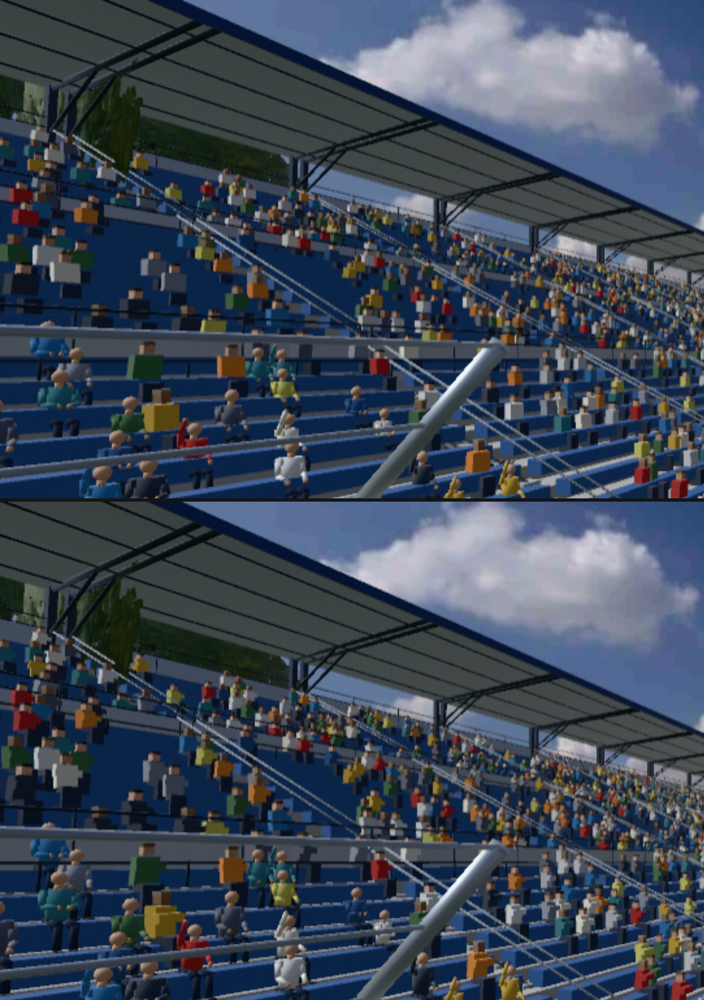
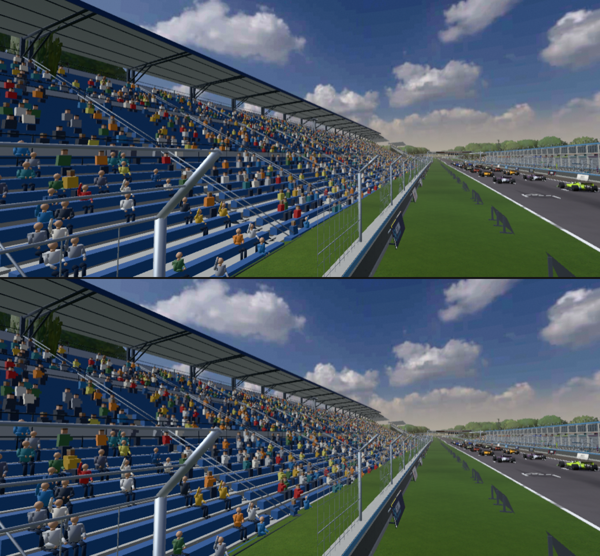
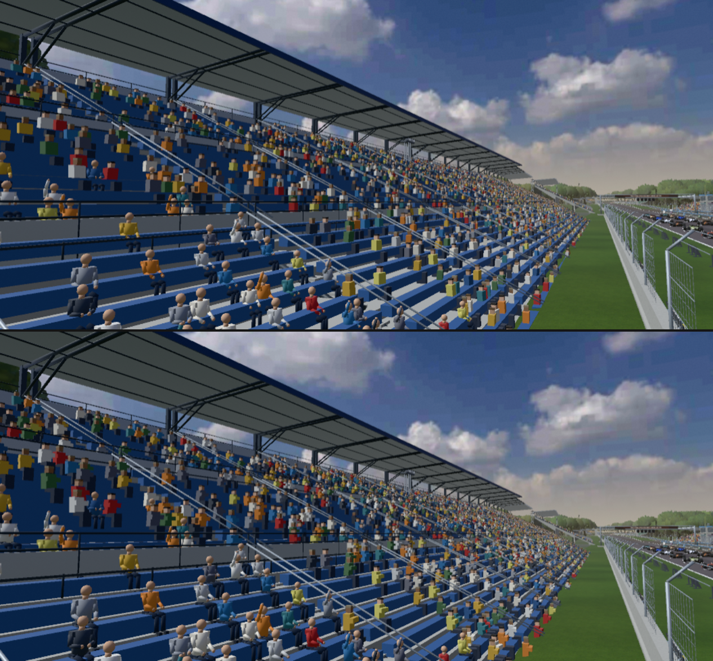
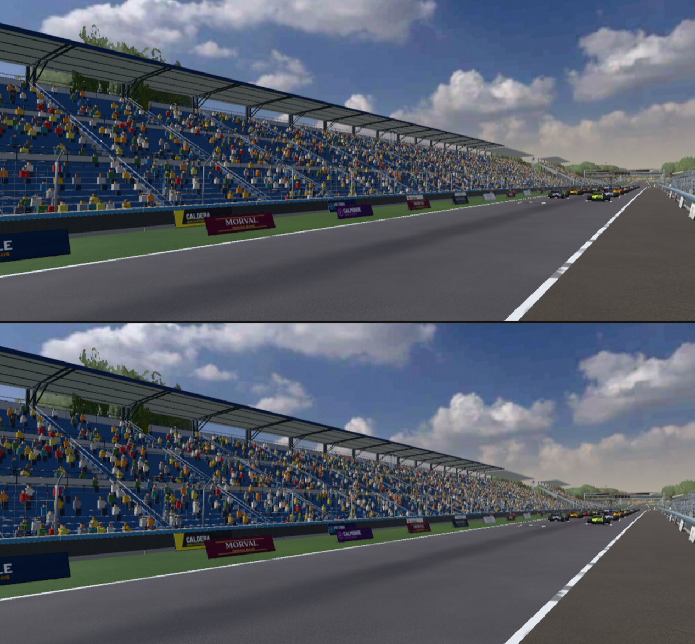
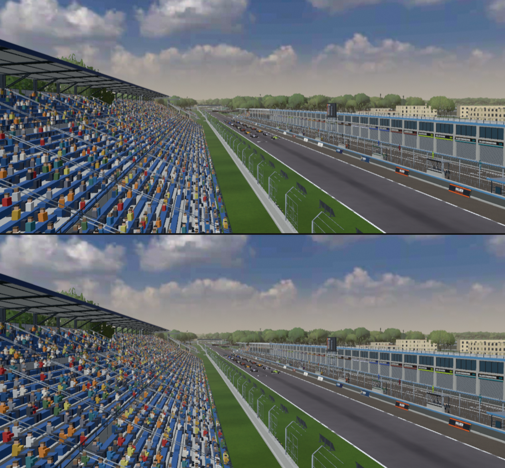
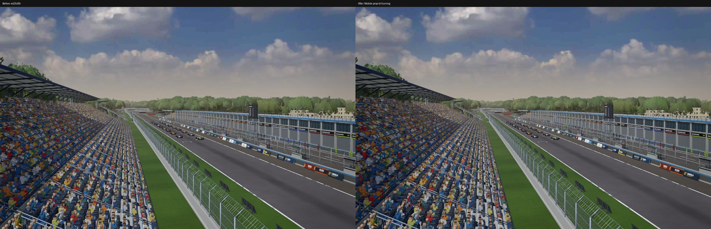
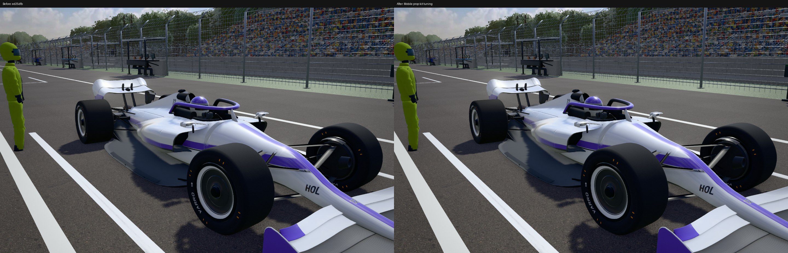

# Mobile prop-kit tuning evidence

Mobile Monza Grid submits 374 calls / 1,446,890 triangles on the GPU, below the pre-#57 ceilings of 384 / 1,465,134 (master: 442 / 1,807,308). The full-world browser test pins 384 calls and 1,465,000 triangles at 844×390 with 20 cars, and it fails on master. No budget, tolerance or test was loosened.

## Review round 2

### The ceiling test now fails on master

The test read the stats four animation frames after the grid setup. On software WebGL most frames skip their draw, so it read a frame from before the grid view and passed on master. It now waits for three frames drawn after the setup (`waitForDraws`) and asserts that they were drawn. Same spec, `npx playwright test tests/browser/world-dressing.spec.ts --project=desktop --workers=1 -g Monza`:

- master 3f3ed77, with this spec copied in: **fails**, `Mobile Monza grid draw calls`, `Expected: <= 384`, `Received: 394`. That frame has 394 calls and 1,749,660 triangles, so the triangle ceiling fails as well.
- head: **passes**, at 326 calls / 1,341,532 triangles.

Outputs: [master](ceiling-test-master.txt), [head](ceiling-test-head.txt).

A probe logging the stats on the 12 drawn frames after these three read the same numbers on every frame, on both builds. Software WebGL at DPR 1 submits fewer calls than the GPU at DPR 3 (head 374 there); in both, only head is under the ceilings.

### Mobile crowd near the stand

On Mobile the stand draws its far level up close. Its seat band stood 0.21 m proud of the seat surface: seated figures sank into it to the hips, with their shins hanging over bare treads. Each row's band is now a bench, its top at the seat surface (the crowd's seat contact) and its front 0.26 m forward, just behind the shins, down to the tread (`benchSeatRows` in `packages/render/src/world/kit-stands.ts`). It moves the band's vertices, so it costs no triangles or calls. Figures now sit on the bench with their feet on the tread.

The compact far figure was a shirt block under a head (40 triangles). It now has the full figure's slim torso under a shoulder bar (50 triangles), so from about 20 m it reads as a person. In the 14–20 m handover it now shares the detailed figure's shoulders, seat and lowered legs. This costs 47,710 triangles at the Grid (1,399,180 → 1,446,890, still 374 calls), leaving 18,244 triangles and 10 calls of headroom.

Measured and rejected, both for the triangle ceiling:

- handover at 34–40 m instead of 14–20 m: Grid 380 calls / 1,648,186 triangles (183k over). The detailed near figure is 368 triangles, and the kit has no cheaper seated level (732 / 368 / 368).
- stand hull switch at 220 m instead of 160 m (non-blocking item 3): Grid 375 calls / 1,476,270 triangles (11k over once the far figure has shoulders). The hull stays at 160 m.

Before (top) and after (bottom), Mobile 844×390 at DPR 3, same poses; before is the merged branch 7541518 without the crowd change.

### Frame time

Interleaved pairs, a fresh muted headless Chromium per sample on the RTX 4050 (ANGLE/GL), uncapped, dynamic resolution fixed at 1; each sample settles 3 s and measures 8 s. Every run held `timeout 900 flock ~/.cache/undercut/gpu.lock` under `nice -n 10 taskset -c 0-7`; batches B to E waited for a 1-minute load under 12 before starting. **Samples with a 1-minute load above 16 at either boundary are discarded**, and medians use clean samples only. Mobile is 844×390 DPR 3, High 1440×900 DPR 1. Records: [samples-review2.json](samples-review2.json).

| Batch | Scenario | Baseline → compared | Clean n | Load > 16, discarded (load range) | drawnMean ms | drawMed ms | drawP95 ms | Calls | Triangles | Repacked meshes |
| --- | --- | --- | --- | --- | --- | --- | --- | --- | --- | --- |
| A | Mobile Grid | master 3f3ed77 → head | 4/4 | 0 of 8 (13–15) | 6.556 → 6.028 | 6.650 → 5.950 | 7.950 → 7.450 | 442 → 374 | 1,807,308 → 1,446,890 | 0 → 0 |
| A | Mobile Grid | pre-#57 dafda8f → head | 2/2 | 4 of 8 (10–19) | 4.994 → 5.947 | 4.550 → 5.500 | 8.150 → 9.200 | 384 → 374 | 1,465,134 → 1,446,890 | 0 → 0 |
| A | High Grid | master 3f3ed77 → head | 0/0 | 8 of 8 (17–21) | discarded | discarded | discarded | 865 → 865 | 5,339,529 → 5,339,529 | 0 → 0 |
| A | Mobile Lesmo | master 3f3ed77 → head | 1/0 | 7 of 8 (16–18) | discarded | discarded | discarded | 291 → 264/265 | 460,798 → 472,046/474,590 | 3 → 0 |
| B | Mobile Grid | pre-#57 dafda8f → head | 6/6 | 0 of 12 (8–10) | 4.123 → 4.307 | 3.800 → 4.050 | 5.500 → 5.700 | 384 → 374 | 1,465,134 → 1,446,890 | 0 → 0 |
| B | High Grid | master 3f3ed77 → head | 4/4 | 0 of 8 (7–8) | 7.998 → 7.796 | 7.650 → 7.450 | 10.550 → 10.400 | 865 → 865 | 5,339,529 → 5,339,529 | 0 → 0 |
| B | Mobile Lesmo | master 3f3ed77 → head | 4/4 | 0 of 8 (7–7) | 4.426 → 4.034 | 4.300 → 3.950 | 6.150 → 5.750 | 290/291 → 265 | 458,254/460,798 → 474,590 | 3 → 0 |
| C | Mobile Grid | merged pre-fix 7541518 → head | 4/4 | 0 of 8 (6–7) | 4.273 → 4.146 | 4.300 → 4.050 | 5.700 → 5.500 | 374 → 374 | 1,399,180 → 1,446,890 | 0 → 0 |
| C | Mobile Grid | pre-#57 dafda8f → merged pre-fix 7541518 | 4/4 | 0 of 8 (6–7) | 4.135 → 4.179 | 3.900 → 4.050 | 5.550 → 5.550 | 384 → 374 | 1,465,134 → 1,399,180 | 0 → 0 |
| D | Mobile Grid | pre-#57 dafda8f → head | 6/6 | 0 of 12 (5–6) | 4.002 → 4.138 | 3.900 → 4.100 | 5.300 → 5.450 | 384 → 374 | 1,465,134 → 1,446,890 | 0 → 0 |
| E | Mobile Grid | PR pre-merge e958939 → merged pre-fix 7541518 | 5/5 | 0 of 10 (5–5) | 3.435 → 3.580 | 3.200 → 3.200 | 4.700 → 5.200 | 374 → 374 | 1,399,180 → 1,399,180 | 0 → 0 |

- **Against master, Mobile is faster and High is not slower.** Mobile Grid 6.556 → 6.028 ms; High Grid 7.998 → 7.796 ms with identical calls and triangles; Mobile Lesmo 4.426 → 4.034 ms with zero repacks (master repacks three meshes).
- **Against pre-#57, head is 0.14 to 0.18 ms slower (batches B and D). The cause is the master merge, not this branch.** At identical geometry (374 / 1,399,180 on both), merging master (#82, #76) into the branch costs 0.145 ms (batch E: e958939 3.435 → merged 3.580 ms). The crowd change itself measured no slower than the merged build before it (batch C, 4 of 4 pairs). Before the merge this branch beat pre-#57 (review round 1, quiet run: 3.400 → 3.057 ms).
- **Mobile Lesmo submits about 3 % more triangles** (460,798 → 474,590), while calls fall 291 → 265. The wider batch cells (stand far cell 800 m, far crowd 600 m, hoarding chunk 400 m) draw off-screen instances in any cell that is partly in view. It is faster on this GPU; on a phone it costs vertex work.

## Review round 1 tables, load-filtered

The first round's tables reported every sample, including those taken while the shared laptop was at a 1-minute load of 17 to 40. Samples above 16 are now discarded. Rows left with fewer than two clean samples a side are marked discarded. Values are baseline → head (02180fa) medians. The earlier "mixed" High Lesmo result was one of these: its clean initial run is parity (13.275 → 13.279 ms).

| Run | Scenario | Baseline | Samples at load > 16 (discarded) | Clean n (base/head) | drawnMean ms | drawMed ms | drawP95 ms |
| --- | --- | --- | ---: | --- | --- | --- | --- |
| initial | Mobile Grid | ed25dfb | 8 of 8 (19–26) | 0/0 | discarded | discarded | discarded |
| initial | Mobile Lesmo | ed25dfb | 8 of 8 (17–21) | 0/0 | discarded | discarded | discarded |
| initial | High Grid | ed25dfb | 2 of 8 (16–16) | 3/3 | 10.921 → 10.976 | 6.200 → 6.200 | 23.200 → 23.100 |
| initial | High Lesmo | ed25dfb | 0 of 8 | 4/4 | 13.275 → 13.279 | 6.600 → 6.300 | 24.200 → 24.000 |
| initial | Mobile Grid | dafda8f | 0 of 8 | 4/4 | 2.515 → 2.506 | 2.300 → 2.300 | 3.150 → 3.200 |
| repeat | Mobile Grid | ed25dfb | 7 of 8 (19–39) | 1/0 | discarded | discarded | discarded |
| repeat | Mobile Lesmo | ed25dfb | 8 of 8 (38–40) | 0/0 | discarded | discarded | discarded |
| repeat | High Grid | ed25dfb | 8 of 8 (32–38) | 0/0 | discarded | discarded | discarded |
| repeat | High Lesmo | ed25dfb | 8 of 8 (27–40) | 0/0 | discarded | discarded | discarded |
| repeat | Mobile Grid | dafda8f | 8 of 8 (25–27) | 0/0 | discarded | discarded | discarded |
| vsync | High Grid | ed25dfb | 2 of 8 (18–19) | 3/3 | 16.919 → 16.728 | 16.700 → 16.700 | 20.200 → 16.900 |
| vsync | High Lesmo | ed25dfb | 8 of 8 (19–21) | 0/0 | discarded | discarded | discarded |

## Review round 1 method and retained data

Each value is the median of four samples, baseline → head. Each pair alternates baseline/head or head/baseline, with a separate fresh muted headless Chromium process for every sample. High is 1920×1080 DPR 1; Mobile is 844×390 DPR 3 (preset cap 1.25). Dynamic resolution is fixed at scale 1. Uncapped draws use the NVIDIA RTX 4050 through ANGLE/OpenGL ES 3.2.

Runs hold `flock ~/.cache/undercut/gpu.lock`, use `nice -n 10 taskset -c 0-7`, and run Playwright with `--workers=1`. Static servers bind free ports; none uses 6151. Each sample settles for 3 s and measures for 8 s. Grid is stationary in the last grid slot with 19 other cars and chase-far. Lesmo starts at s=2196 m, 200 km/h with the keyboard autopilot and chase-near; measured end positions are recorded per sample (roughly s=2359 m).

`renderStats()` is read only at the two boundaries. The rAF observer reads only `drawnCount` and `lastDrawIntervalMs`; drawnMean is elapsed real time divided by drawn frames, and drawMed/drawP95 are percentiles of the drawn-frame intervals. Repacks count changes to prop instance-matrix versions at the boundaries, across all prop meshes. All five baseline Lesmo updates were roofed-stand batches; head records zero. Calls and triangles describe the last drawn frame, including all passes.

Source-map contents were checked against all renderer source files: 54 files match `ed25dfb` for base, 50 match the archived `dafda8f` build, and 54 match `02180fa` for head. Later commits add tests and documentation only. The pre-#57 source archive has its own workspace links, so it cannot resolve current renderer sources through the working tree's packages.

The shared laptop was busy during parts of both uncapped runs. A separate normal-vsync High control retains the same setup and four interleaved pairs per scenario, with only the uncapped launch flags removed. This distinguishes player-visible frame delivery from uncapped/headless pacing sensitivity; the original review used the same control. The first round dropped no samples; its tables above now discard every sample taken at a 1-minute load above 16. The [sample records](samples.json) include load averages, actual routes, timing summaries, counts and each repacked mesh. Full interval arrays, the harness and logs remain in `/home/devansh/.cache/undercut/scratch/render-mobile-kit-tuning/` (`benchmark.json`, `benchmark-repeat.json`, `benchmark-vsync.json`, `bench.spec.cjs`, `bench.config.cjs`).

## Validation

- `npx vitest run --project unit packages/render/test`: 22 files, 167 tests passed.
- `npm run build`, `npm run typecheck` and `npm run lint` passed.
- `npx playwright test tests/browser/world-dressing.spec.ts --project=desktop --workers=1 -g Monza` passes on head and fails on master (above).

## Review round 1 screenshots

Before is left, after is right. Mobile panels are 844×390 CSS pixels, captured at DPR 3 then reduced to CSS size; High panels are the original 1440×900 pixels. Intro overlay and HUD are hidden on both builds. The same static poses show the grid, stand straight and close pit lane. Mobile keeps the roof and structural frame; the less detailed seat pans and far spectators are intentional.

### Mobile grid-chase

### Mobile stand-straight

### Mobile pit-lane

### High grid-chase

### High stand-straight

### High pit-lane

## Remaining limits

These are desktop GPU results at the Mobile preset and resolution, not a physical-phone measurement. The hill-garage hull includes the deep canopy and rooftop service volume, while terrace guardrails and canopy tie-rods remain omitted as documented in `docs/render.md`. High retains its existing geometry and LOD distances.
