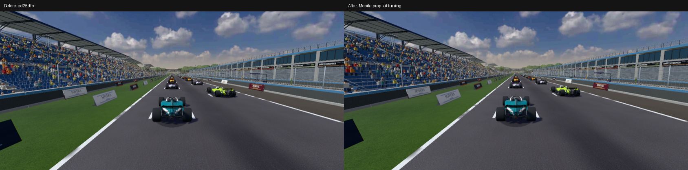
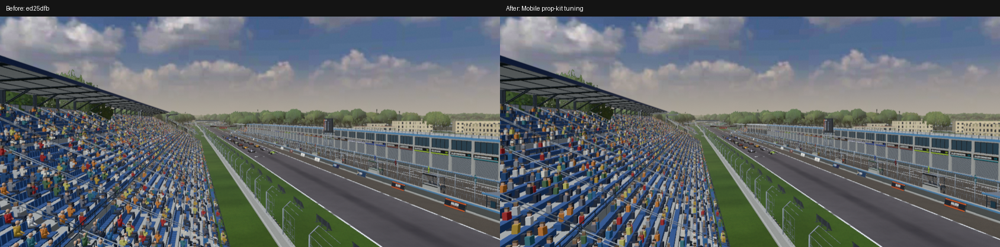
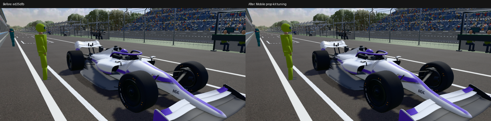
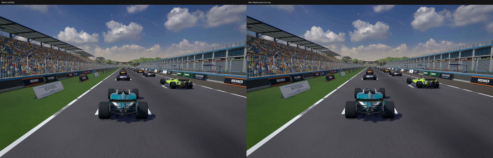

# Mobile prop-kit tuning evidence

Mobile Monza Grid submits 374 calls / 1,399,180 triangles, below the pre-#57 ceilings of 384 / 1,465,000. The full-world browser test pins both ceilings with 20 cars at 844×390. No existing budget, tolerance or test was loosened.

Mobile Grid meets the pre-#57 frame-time target in both uncapped comparisons: drawnMean 2.515 → 2.506 ms initially and 8.183 → 8.092 ms in the repeat. The repeat also improves drawMed and drawP95 while reducing calls and triangles.

High Grid submits identical geometry and calls. Its uncapped repeat improves all three timing summaries; its initial and normal-vsync drawnMean are slightly higher on head, with unchanged or improved drawMed and drawP95. High Lesmo has mixed uncapped timings (including a slower contended repeat), while the normal-vsync control improves drawnMean 16.967 → 16.803 ms and p95 20.950 → 19.800 ms at the same 16.700 ms median. All twelve head Lesmo samples have zero repacks. These measurements do not establish a consistent High timing penalty or a general High speedup; the uncapped host/pacing sensitivity remains a limitation, and the controls do not identify its exact cause.

## Normal-vsync High control

| Scenario | Baseline | Pairs | drawnMean ms | drawMed ms | drawP95 ms | Calls | Triangles | Repacks |
| --- | --- | ---: | --- | --- | --- | --- | --- | --- |
| High Grid | ed25dfb | 4 | 17.068 → 17.307 | 16.700 → 16.700 | 21.350 → 20.400 | 1,035 → 1,035 | 5,824,297 → 5,824,297 | 0 → 0 |
| High Lesmo | ed25dfb | 4 | 16.967 → 16.803 | 16.700 → 16.700 | 20.950 → 19.800 | 600 → 600 | 1,999,097 → 1,999,253 | 5 → 0 |

## Repeat uncapped benchmark

| Scenario | Baseline | Pairs | drawnMean ms | drawMed ms | drawP95 ms | Calls | Triangles | Repacks |
| --- | --- | ---: | --- | --- | --- | --- | --- | --- |
| Mobile Grid | ed25dfb | 4 | 12.708 → 11.918 | 12.000 → 10.850 | 21.150 → 20.300 | 442 → 374 | 1,807,308 → 1,399,180 | 0 → 0 |
| Mobile Lesmo | ed25dfb | 4 | 11.923 → 11.199 | 10.950 → 10.600 | 18.750 → 20.100 | 290 → 264 | 456,774 → 472,742 | 5 → 0 |
| High Grid | ed25dfb | 4 | 23.073 → 21.204 | 22.100 → 20.750 | 37.200 → 32.300 | 1,035 → 1,035 | 5,824,297 → 5,824,297 | 0 → 0 |
| High Lesmo | ed25dfb | 4 | 12.110 → 15.181 | 11.350 → 13.700 | 19.000 → 26.850 | 600 → 599 | 1,999,253 → 1,999,133 | 5 → 0 |
| Mobile Grid | dafda8f | 4 | 8.183 → 8.092 | 7.300 → 7.000 | 12.200 → 12.050 | 384 → 374 | 1,465,134 → 1,399,180 | 0 → 0 |

## Initial uncapped benchmark

| Scenario | Baseline | Pairs | drawnMean ms | drawMed ms | drawP95 ms | Calls | Triangles | Repacks |
| --- | --- | ---: | --- | --- | --- | --- | --- | --- |
| Mobile Grid | ed25dfb | 4 | 7.215 → 8.717 | 6.250 → 7.800 | 13.050 → 14.500 | 442 → 374 | 1,807,308 → 1,399,180 | 0 → 0 |
| Mobile Lesmo | ed25dfb | 4 | 7.148 → 5.494 | 6.500 → 4.950 | 12.150 → 9.950 | 290 → 265 | 458,254 → 474,590 | 5 → 0 |
| High Grid | ed25dfb | 4 | 10.775 → 11.010 | 6.300 → 6.250 | 23.200 → 23.050 | 1,035 → 1,035 | 5,824,297 → 5,824,297 | 0 → 0 |
| High Lesmo | ed25dfb | 4 | 13.275 → 13.279 | 6.600 → 6.300 | 24.200 → 24.000 | 600 → 599 | 2,005,997 → 1,997,513 | 5 → 0 |
| Mobile Grid | dafda8f | 4 | 2.515 → 2.506 | 2.300 → 2.300 | 3.150 → 3.200 | 384 → 374 | 1,465,134 → 1,399,180 | 0 → 0 |

## Method and retained data

Each value is the median of four samples, baseline → head. Each pair alternates baseline/head or head/baseline, with a separate fresh muted headless Chromium process for every sample. High is 1920×1080 DPR 1; Mobile is 844×390 DPR 3 (preset cap 1.25). Dynamic resolution is fixed at scale 1. Uncapped draws use the NVIDIA RTX 4050 through ANGLE/OpenGL ES 3.2.

Runs hold `flock ~/.cache/undercut/gpu.lock`, use `nice -n 10 taskset -c 0-7`, and run Playwright with `--workers=1`. Static servers bind free ports; none uses 6151. Each sample settles for 3 s and measures for 8 s. Grid is stationary in the last grid slot with 19 other cars and chase-far. Lesmo starts at s=2196 m, 200 km/h with the keyboard autopilot and chase-near; measured end positions are recorded per sample (roughly s=2359 m).

`renderStats()` is read only at the two boundaries. The rAF observer reads only `drawnCount` and `lastDrawIntervalMs`; drawnMean is elapsed real time divided by drawn frames, and drawMed/drawP95 are percentiles of the drawn-frame intervals. Repacks count changes to prop instance-matrix versions at the boundaries, across all prop meshes. All five baseline Lesmo updates were roofed-stand batches; head records zero. Calls and triangles describe the last drawn frame, including all passes.

Source-map contents were checked against all renderer source files: 54 files match `ed25dfb` for base, 50 match the archived `dafda8f` build, and 54 match `02180fa` for head. Later commits add tests and documentation only. The pre-#57 source archive has its own workspace links, so it cannot resolve current renderer sources through the working tree's packages.

The shared laptop was busy during parts of both uncapped runs. A separate normal-vsync High control retains the same setup and four interleaved pairs per scenario, with only the uncapped launch flags removed. This distinguishes player-visible frame delivery from uncapped/headless pacing sensitivity; the original review used the same control. No samples were dropped. The [sample records](samples.json) include load averages, actual routes, timing summaries, counts and each repacked mesh. Full interval arrays, the harness and logs remain in `/home/devansh/.cache/undercut/scratch/render-mobile-kit-tuning/` (`benchmark.json`, `benchmark-repeat.json`, `benchmark-vsync.json`, `bench.spec.cjs`, `bench.config.cjs`).

## Validation

- `npm test -- --maxWorkers=2 packages/render/test`: 22 files, 166 tests passed.
- `npm run build`: production build and all transfer/code budgets passed.
- `npm run typecheck`: passed across the workspace.
- `npm run lint`: ESLint, formatting, game-name and real-name checks passed.
- `npx playwright test tests/browser/world-dressing.spec.ts --project=desktop --workers=1`: all 3 tests passed (Monza, Spa, Singapore), including the Mobile grid ceiling.

## Screenshots

Before is left, after is right. Mobile panels are 844×390 CSS pixels, captured at DPR 3 then reduced to CSS size; High panels are the original 1440×900 pixels. Intro overlay and HUD are hidden on both builds. The same static poses show the grid, stand straight and close pit lane. Mobile keeps the roof and structural frame; the less detailed seat pans and far spectators are intentional.

### Mobile grid-chase

### Mobile stand-straight

### Mobile pit-lane

### High grid-chase

### High stand-straight

### High pit-lane

## Remaining limits

These are desktop GPU results at the Mobile preset and resolution, not a physical-phone measurement. The hill-garage hull includes the deep canopy and rooftop service volume, while terrace guardrails and canopy tie-rods remain omitted as documented in `docs/render.md`. High retains its existing geometry and LOD distances.
