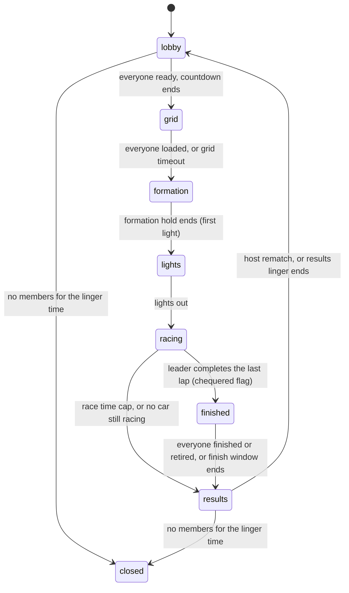

# Netcode: rooms, protocol and the client library

Friends race in private rooms by invite code. Every browser simulates its own car; the
rooms service is the referee. It owns the clock, the grid, the start, session phases,
timing checks and results, relays car snapshots, and keeps a race alive through lag,
hidden tabs, reconnects and the host leaving. Decisions are in [ADR 0003](adr/0003-netcode.md).

| Piece | Where | Runs |
| --- | --- | --- |
| Protocol: messages, validators, binary snapshots, room codes, names, settings | `packages/protocol/src/*.ts` | client and service |
| Room state machine (all room rules) | `packages/protocol/src/room/` | service (and Node tests) |
| Client library | `packages/protocol/src/client/` | browser (and Node tests) |
| Durable Object shell and HTTP routes | `services/rooms/src/` | local Workers runtime (`wrangler dev`) |
| Network simulator, headless driver, soak | `tools/netsim/` | tests |

Everything in `packages/protocol` is pure: no DOM, no wall clock, no `Math.random`. The
room is a state machine that takes `(event, now)` and returns messages to send; the
Durable Object only does I/O, alarms and storage. That is why nearly all of the rules
are unit-tested in Node with a fake clock.

## Endpoints

All under the same-origin `/rooms` prefix that `./start.sh` proxies to the service.

| Request | Answer |
| --- | --- |
| `GET /rooms/health` | `{ ok, service: "rooms", protocol }` |
| `POST /rooms` | `201 { code, maxHumans, protocol }`, or `429` past the creation limit |
| `GET /rooms/<code>` | `200 { code, phase, humans, maxHumans, joinable }` or `404` (for invite links) |
| `GET /rooms/<code>/ws` (upgrade) | the room WebSocket; `404` if the room does not exist, `426` without an upgrade |

Codes are accepted in any case and with a space or dash in the middle (`bcd-fgh`).

## Room codes and names

- **Codes**: six characters from `BCDFGHJKMNPQRSTVWXZ23456789`: no vowels (so no words,
  and no list of words to maintain) and none of the look-alikes 0/O, 1/I/L. That is
  27^6, about 3.9 x 10^8 codes (28.5 bits), drawn with `crypto.getRandomValues`. A code
  only lives as long as its room.
- **Names**: NFC-normalised; control characters, bidi overrides and zero-width
  characters removed; runs of white space collapsed; 1 to 24 code points. Anything
  else is refused with `name_invalid`.

## Messages

Control messages are JSON text frames. Each has a `type`; every field is checked by type
and range, unknown fields are refused, and nothing is ever coerced (no `String(x)` of a
client value), so hostile values such as `{"toString": null}` cannot throw. Every
validator is fuzzed with 20 000 hostile inputs in `packages/protocol/test/messages.test.ts`.

### Client to server

| Type | Fields | Accepted in | Max chars |
| --- | --- | --- | --- |
| `join` | `v` (protocol version), `name`, `resume?` (32 hex) | first message on a socket | 512 |
| `ping` | `id`, `t` (client clock, echoed) | always | 128 |
| `ready` | `ready` | lobby | 64 |
| `settings` | `patch`: any of `circuit`, `laps`, `equalCars`, `aiCount`, `aiSkill`, `assists`, `gridOrder` | lobby, host only | 1024 |
| `kick` | `member` | any, host only | 96 |
| `loaded` | | grid (harmless later) | 32 |
| `lap` | `seat`, `lap`, `lapMs`, `raceMs`, `sectorsMs?`, evidence: `tick`, `s`, `speed`, `at` | racing, finished | 512 |
| `limits` | `seat`, `lap` (a track-limits infringement) | racing, finished | 96 |
| `jump_start` | `seat` | formation, lights, racing | 64 |
| `pit` | `seat`, `event` (`entry`, `box`, `exit`), `lap`, `at` | racing, finished | 160 |
| `retire` | `seat` | grid to finished | 64 |
| `rematch` | | results, host only | 32 |
| `leave` | | always | 32 |

A valid message in a phase that does not take it gets `wrong_phase` (no strike).
`PHASE_ACCEPTS` in `room/machine.ts` is the table, tested phase by phase.

### Server to client

| Type | When | Contents |
| --- | --- | --- |
| `welcome` | after `join` | your member id, resume token, seat, `epoch` (for snapshot times), server `now`, the room, and on a resume your last car snapshot and counted progress |
| `room` | any change everyone should see | phase and its deadline, host, settings, members (seat, ready, loaded, connected, status), AI seats, grid with each car's state, start schedule, chequered time |
| `pong` | each `ping` | `id`, your `t`, server `now` |
| `start` | entering formation | `lightsStartAt`, `lightIntervalMs`, `lightCount`, `lightsOutAt` (server times) |
| `timing` | each crossing claim | lap, times, `status` (`accepted`, `flagged`, `rejected`) and `reason`; rejections go to the sender only |
| `penalty` | jump start, track limits | seat, ms, reason, total |
| `limits` | each track-limits report | seat, lap, warnings so far |
| `pit` | relayed pit events | seat, event, lap, time |
| `host` | host change, or more AI for the host | new host, and every AI car with its laps, race time, state and last snapshot |
| `results` | race end | the final classification, identical for everyone |
| `error` | a refused message | stable `code` and a human-readable `detail` |

Error codes (`ERROR_CODES` in `errors.ts`, never renamed): `bad_json`, `bad_message`,
`too_large`, `unknown_type`, `version_mismatch`, `internal_error`, `rate_limited`,
`not_joined`, `already_joined`, `name_invalid`, `room_full`, `room_closed`,
`race_in_progress`, `resume_invalid`, `resume_expired`, `not_host`, `wrong_phase`,
`bad_settings`, `no_such_member`, `not_owner`, `kicked`, `too_many_strikes`.

Close codes: 4000 left, 4001 kicked, 4002 resume expired, 4003 room closed, 4004 too
many strikes, 4005 room full, 4006 race in progress, 4007 version mismatch, 4008 no
join in time, 4009 replaced by a newer socket for the same member, 4010 unknown resume
token, 4011 bad name. All but 4008 are terminal: the client does not reconnect.

### Car snapshots (binary)

Fixed 56-byte little-endian records, chosen field by field (`snapshot.ts` has the table):

| Field | Wire | Resolution | Worst error |
| --- | --- | --- | --- |
| seat, flags | u8, u8 | | exact |
| tick (sender sim tick) | u32 | | exact |
| t (sender's estimate of server time) | u32, ms after the room epoch | 1 ms | 0.5 ms |
| x, y, z | i32 | 1 mm | 0.5 mm |
| yaw, pitch, roll | i16 | pi / 32768 rad | 4.8e-5 rad |
| vx, vy, vz | i16 | 1 cm/s (to 327 m/s) | 5 mm/s |
| yaw rate | i16 | 1 mrad/s | 0.5 mrad/s |
| steer | i8 | 1/127 | 0.004 |
| throttle, brake | u8 | 1/255 | 0.002 |
| gear | i8 | -1 to 8 | exact |
| rpm | u16 | 1 rpm | 0.5 rpm |
| wheel spin x 4 | i16 | 0.05 rad/s | 0.025 rad/s |
| lap (completed), s | u16, u32 | 1 mm | 0.5 mm |

Out-of-range values clamp and non-finite ones encode as 0, so a bad sim value never
throws. 10 000 random cars round-trip inside these bounds in the tests.

Frames: client to server `[1, count, records...]` (a guest sends its own car, the host
also its AI cars); server to client `[2, count, receivedAt u32, records...]`, stamped with
the server receive time.

**Size and bandwidth.** 56 bytes a car. At 30 Hz with 20 cars a client receives the
other 19: 19 x 56 x 30 = 31.9 kB/s of records, plus 6 bytes a frame of header (about
33 kB/s, 270 kbit/s). A guest sends 62 bytes a tick (1.9 kB/s); the host with 12 AI
sends 13 cars, 734 bytes a tick (22 kB/s). The soak measures 31.1 KiB/s down per client
and 24.3 / 2.0 KiB/s up for host and guest, including control traffic and simulated loss.

**Relay.** The service relays each frame as it arrives to everyone else in the room. It
drops a snapshot whose tick is not newer than the last one it relayed for that seat
(stale or duplicate), and drops cars the sender does not drive (`not_owner`).

## Phases



| Timer (default) | Meaning |
| --- | --- |
| ready countdown, 3 s | all members ready (and connected): countdown to the grid; any change cancels it |
| grid timeout, 20 s | wait for every client to load the circuit |
| formation, 3 s | cars hold on the grid before the first light |
| lights, 5 x 1 s, then a random hold of 0.2 to 3 s | see the start procedure |
| race cap | laps x `circuit.maxLapMs`, at most 4 h |
| finish window | after the chequered flag: 2 x minimum lap time, at least 15 s, at most `maxLapMs` |
| results linger, 30 s | then back to the lobby by itself |
| stale 2 s, away 6 s | a racer sending no snapshots |
| grace, 60 s | to resume a seat after a disconnect (or after going away) |
| join timeout, 10 s | a socket that never joins is closed |
| room linger, 30 s; empty room, 10 min | a room with no members closes |

The service reads `ROOM_TIMINGS` (JSON) to override these; the runtime tests use it to
compress a race into seconds. Clients cannot change them.

Rematch keeps the members and settings and clears ready flags. A newcomer can join in the
lobby or at the results, not mid-race (`race_in_progress`).

## Clock sync

The client pings six times 150 ms apart after joining, then every 2 s. For a ping sent at
local time `t0`, answered with server time `S`, received at `t1`: offset `S - (t0+t1)/2`,
error at most `(t1-t0)/2`. The estimate is the median offset of the fastest third of the
last 16 samples, and its error bound is half the slowest round trip among those. The
client exposes `serverNow()` and `localTimeOf(serverTime)`.

## The start

1. When the grid forms or times out, the server picks the random hold (0.2 to 3 s, from
   `crypto.getRandomValues`) and broadcasts the whole schedule in one `start` message:
   first light at `lightsStartAt`, one more every `lightIntervalMs`, all out at
   `lightsOutAt` (after the last light plus the hold).
2. Each client converts those server times to its own clock with `localTimeOf` and shows
   the lights and releases the car at the same server instant. The runtime test checks
   two clients put lights out at the same local instant within the sum of their
   clock-sync error bounds.
3. **Jump starts** are caught twice: the client reports its own (`jump_start`), and the
   server penalises any car whose snapshot arrives before `lightsOutAt` moving faster than
   1 m/s (a snapshot received before lights out was certainly sent before it, so this
   needs no clock tolerance). 5 s penalty, once.

Because the schedule is announced ahead, a modified client could know the hold. That is
accepted: it removes only the guessing, and the server still sees early movement.

## Timing plausibility

Each client reports its own line crossings (the host reports its AI cars). The server
keeps the official classification from those claims after checking them. It is a
**plausibility referee, not an anti-cheat system**: it catches bugs, desyncs and crude
tampering, not a modified client that reports a consistent, slightly faster race.

A claim is **rejected** (it does not count; the sender is told why) when:

| Reason | Check |
| --- | --- |
| `not_owner` | the sender does not drive that seat (humans their own, the host the AI) |
| `not_racing` | the car has finished or retired |
| `duplicate` | the same lap and race time again (retries are harmless) |
| `lap_not_monotonic` | a lap number at or below the last counted one |
| `timestamp_implausible` | the claimed crossing time is more than 10 s from its arrival, or before lights out |
| `crossed_while_disconnected` | the claimed crossing time falls in one of the member's disconnections |
| `lap_too_fast` | under the circuit's minimum lap time |
| `sector_too_fast` | a sector under its minimum |
| `bad_sectors` | wrong number of sectors, or they do not add up to the lap time |
| `race_time_mismatch` | lap time differs from the race-time difference by more than 5 ms |
| `gap_too_fast` | skipped laps whose race time is shorter than that many minimum laps |
| `s_inconsistent` | the car's latest snapshot is not on the lap before or after the line, or further from the line than 120 m/s could cover since |

A claim is **flagged** (it counts, and the flag shows in the results) when:

| Reason | Check |
| --- | --- |
| `no_snapshot_evidence` | no snapshot of that car in the last 3 s to check against |
| `time_mismatch` | the lap time differs from the gap between the server's own receipt of the two crossings by more than max(2 s, 10 %) |

Minimum lap and sector times come with the room settings (`circuit`), computed by the
host's client from the track data with `circuitLimits`: distance over 95 m/s (342 km/h,
a mean no car sustains). A rejected lap does not freeze a car's progress: the next good
claim may skip laps if its race time covers them.

**Penalties.** Jump start 5 s. Track limits: three free warnings, then 5 s for each
further one; a lap with a report does not count for best lap.

**The flag.** The first car to complete the race distance takes the chequered flag.
Every other car finishes on its first crossing at or after the leader's race time, so a
lapped car finishes a lap down. This is decided on race times, which each client measures
on its own sim clock from lights out, not on the order the messages reach the server:
a crossing just before the leader's, delivered just after it, is still a normal lap.

**Classification.** Running and finished cars by laps (more first), then race time plus
penalties, then grid position; retired cars after them, ordered the same way. The same
`results` object goes to everyone (the soak checks all eight copies are identical).

## Seats, AI, leaving and reconnecting

- Up to 8 humans, AI filling up to `aiCount` seats so the grid never exceeds 20 cars.
  Seats are the lowest free numbers; humans keep theirs for the room's life. The grid is
  random by default (or join order), shuffled with the server's randomness.
- **AI runs on the host's browser**, which sends its snapshots and timing claims.
- **Host migration**: if the host leaves, disconnects or goes away, the host role passes at
  once to the longest-connected human who is connected and not away. The `host` message
  carries every AI car's counted laps, race time and last snapshot, so the new host's
  AI continues from there. A former host who comes back is a guest.
- **A member who leaves**: in the lobby or results the seat is free; between the grid
  and lights out the car becomes an AI car (the grid stays full); once racing it retires
  (DNF).
- **Stale and away**: a racer whose snapshots stop is `stale` after 2 s and `away` after
  6 s (its grace period starts, as for a disconnect). A tab that comes back and sends
  snapshots is `active` again.
- **A silent or disconnected car is a ghost**, chosen over handing it to the host's AI:
  others see it extrapolated for at most 250 ms, then held, then faded out over 0.5 s,
  and the game lets cars drive through a held or fading car. Handing a human's car to AI
  would need a full car-state handover and would race on the player's behalf; a ghost
  cannot change the result.
- **Reconnect**: within the grace period (60 s) a `join` with the resume token takes the
  same member, seat and car back; `welcome` brings the last snapshot and counted
  progress, and a returning host gets the AI list. A newer socket for the same member
  closes the older one (4009). After the grace period the seat is gone: the car is DNF
  and a resume gets `resume_expired`.
- **Kick**: the host removes a member; their token is retired and cannot resume.
- **Room closing**: when the last member is gone for 30 s (10 min if nobody ever joined)
  the room closes, its sockets get 4003, and its storage is deleted.

## Limits and abuse

| Limit | Value |
| --- | --- |
| Text frame size | 1024 chars before parsing, then the per-type maximum above |
| Snapshot frame size | 2 + 20 x 56 bytes |
| Control messages | token bucket per socket: 20 burst, 10/s |
| Pings | 10 burst, 5/s |
| Snapshot frames | 45 burst, 36/s |
| Strikes | each invalid, over-rate or not-owner message is a strike; one is forgiven every 10 s; 10 close the socket (4004) |
| Rate-limit replies | at most one `rate_limited` error a second |
| Rooms per socket | one: a socket joins the room in its URL once (`already_joined` after) |
| Room creation | 30 per 10 minutes per client address (`CREATE_LIMIT`), keyed on `cf-connecting-ip`, which the local proxy sets from the socket address |
| Members | 8 humans (`room_full`) |

**Not protected**: a modified client can drive its own car however it likes (state sync
trusts each client for its own car) and can report a consistent faster race within the
plausibility bounds; the host's client can do the same for the AI; the lights-out time is
known in advance; there are no accounts, so a kicked player can join again under a new
name while the room is in the lobby. None of this needs more for private rooms among
friends; a public mode would need server-side simulation checks.

## Durable Object

One Durable Object per room code, using the WebSocket hibernation API, so an idle lobby
costs nothing. While cars are on track, snapshot traffic and a 500 ms alarm keep it
awake. The machine's state is written to storage after every control event (not after
snapshots), so a room survives eviction in the lobby and results. An alarm is kept at the
machine's next deadline; later deadlines never move an earlier alarm, so snapshot traffic
does not write alarms. Snapshot bookkeeping (last snapshot per car) lives in memory only.

## Client library

```ts
import { RoomClient, roomsApi, webSocketTransport } from '@undercut/protocol';

const api = roomsApi(roomsUrl(), fetch);           // roomsUrl() from apps/web settings
const { code } = await api.create();
const client = new RoomClient({
  url: api.socketUrl(code),
  name: 'Ana',
  transport: webSocketTransport((url) => new WebSocket(url)),
  timers: { now: () => performance.now(), setTimeout, clearTimeout },
  random: Math.random,
  resume: sessionStorage.getItem(`room:${code}`),   // take the seat back after a reload
});
client.on('welcome', () => sessionStorage.setItem(`room:${code}`, client.resumeToken!));
client.on('start', (s) => scheduleLights(client.localTimeOf(s.lightsOutAt)));
client.connect();

// Each frame:
if (client.snapshotDue()) client.sendSnapshots(myCars());      // 30 Hz, never queued
const remote = client.remoteCars.sample(client.serverNow()!);  // interpolated views
```

- **Sending**: `sendSnapshots` sends at most every 33 ms, never bursts to catch up after a
  stall, and skips a slot while the socket has more than 16 kB queued (backpressure).
  Snapshot `t` should be `serverNow()` at the sim state.
- **Remote cars**: all remote cars are shown at one server time, `serverNow - delay`,
  where the delay is the worst sender's smoothed transit time plus one send interval plus
  three mean deviations of jitter (50 ms to 1 s, slewed 2 ms per sample so motion stays
  smooth). Position is a cubic Hermite curve through the two snapshots around that time
  using their velocities, so a lost snapshot costs almost nothing on a curve. Past the
  newest snapshot it extrapolates with velocity and yaw rate for up to 250 ms, then holds
  for 1 s, then fades over 0.5 s (`mode`, `opacity` on each view).
- **Reconnect**: on an unexpected close it retries with exponential backoff (250 ms
  doubling to 5 s, +-25 % jitter, 30 attempts) and resumes the seat. Timing reports made
  while reconnecting are queued (up to 64) and sent after; other messages are dropped.
- **Events**: `status`, `welcome`, `room`, `start`, `timing`, `penalty`, `limits`, `pit`,
  `host`, `results`, `error`, `snapshots`, `closed` (with the last error, if any).

## Tests

| Command | What |
| --- | --- |
| `npm test` | validators (with fuzzing), snapshot codec bounds, the state machine (every phase x every message, plus scenarios), timing referee, classification, client library against an in-memory room, network simulator |
| `npm run test:rooms` | real WebSockets against `wrangler dev`: endpoints, invalid input, strikes, rate limits, creation limit, a full three-lap race with two humans and host AI (synchronised start, fan-out, identical classification, rematch), leaving, host migration mid-race with AI handover, reconnect within and after grace, and a short soak |
| `npm run test:soak` | the soak at full length (nightly) |

**Soak** (`tools/netsim/soak.runtime.test.ts`): eight headless clients, each behind the
network simulator at 150 +- 50 ms one way, 2 % loss, 1 % duplication, against the real
service, twelve AI cars on the host, on a synthetic circular circuit where every car's
true position is a known function of time. It asserts identical phase sequences, start
schedules and classifications on all clients, the expected finishing order with no
rejected lap, remote-car error under 10 cm at the 99th percentile and 3 m at worst (both
derived in the file), bounded buffers and in-flight queues, and no errors in the service
log. The service clock is the real one, so the race runs in real time: 3 laps (about 30 s)
in CI, 12 laps (about 4 minutes) nightly.

The simulator treats snapshots as an unreliable stream (delayed independently, so jitter
reorders them; dropped; duplicated) and control messages as TCP does (in order, once;
loss becomes a retransmission delay), because that is what a WebSocket gives.
